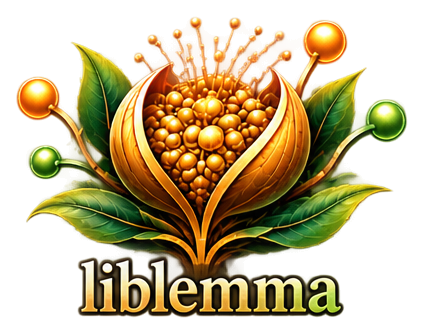

<p align="center">
  
</p>

# @tty-pt/lemma

[](#)
[](#)
[](#)
[](#)
[](#)
[](#)

> Universal Node.js and Browser bindings for **`liblemma`**, the pure-C lexical tokenization, Unicode case-folding, lossless subword encoding, and full-text search engine. Represents the canonical **Text Axis** in the Corm Recall Kernel.

---

## 1. Quickstart

```bash
npm install @tty-pt/lemma
```

```typescript
import { foldAccents, tokenize, encodeTokens, decodeTokens, LemmaIndex } from "@tty-pt/lemma";

// 1. Unicode Case Folding (lowercasing while preserving language-specific accents)
const folded = foldAccents("Pão de Évora");
console.log(folded); // "pão de évora"

// 2. Tokenization into normalized word units & lossless subword encoding
const tokens = tokenize("O pão fresco na padaria!");
console.log(tokens); // ["pão", "fresco", "na", "padaria"]

const subwords = encodeTokens("Pão de queijo");
console.log(decodeTokens(subwords)); // "Pão de queijo"

// 3. Fast In-Memory Lexical Indexing & Search
const index = new LemmaIndex();
index.addDocument(1, "Padaria tradicional com pão fresco");
index.addDocument(2, "Restaurante de peixe grelhado");
index.addDocument(3, "Café com pão de queijo");

const results = index.search("pão");
console.log(results); // [{ id: 1, score: 1 }, { id: 3, score: 1 }]
```

---

## 2. Invariants & Multilingual Features

- **Accent-Sensitive Preserving**: Unlike crude regex lowercasing that destroys diacritics, `lemma_fold` respects Unicode character properties (`Pão` $\rightarrow$ `pão`, `Straße` $\rightarrow$ `straße`, `ÉTÉ` $\rightarrow$ `été`).
- **Instant Search-as-You-Type**: Runs in browser inputs via pre-compiled `dist/lemma.wasm` with sub-millisecond query execution and zero external runtime dependencies.

---

## 3. JavaScript / TypeScript API Reference

### `foldAccents(text: string): string`
Applies Unicode-compliant case folding and diacritic normalization according to language rules. **Executes strictly in compiled WebAssembly / C** via `lemma_fold()`, with zero regex heuristic stripping.

### `tokenize(text: string): string[]`
Tokenizes a string into normalized word tokens by folding accents and splitting on non-alphanumeric word boundaries.

### `encodeTokens(text: string): Uint16Array` / `decodeTokens(tokens: Uint16Array | number[]): string`
Lossless subword BPE encoding (`lemma_tok_encode`) and string reconstruction (`lemma_tok_decode`).

### `LemmaIndex`
In-memory lexical search index backed by C `lemma_db_t`:
* `.addDocument(id: number | string, text: string, field?: string): void`: Indexes a document's text tokens (`index` / `indexRef`).
* `.removeDocument(id: number | string, text: string, field?: string): void`: Differential un-indexing (`unindex` / `unindexRef`).
* `.storeTyped(ref: number, data: Uint8Array | Buffer, qtype?: number): boolean`: Ingests HTOK v4 UTF-8 text or varint token streams.
* `.search(query: string, field?: string): Array<{ id: number | string, score: number }>`: Performs token matching and returns documents ranked by overlap score.
* `.clear()` / `.close()`: Clears or releases the underlying index handle.

### `LemmaLexicalAxis`
Plug-and-play Text Axis adapter for the Corm Recall Kernel (`@tty-pt/corm`):
* `.registerText(ref: number, text: string): void`
* `.fill(params: { term: string, phrase?: boolean }): number[]`
* `.rank(params: { term: string }, ref: number): number`

### `getLemmaWasm(): WebAssembly.Instance`
Returns the WebAssembly instance loaded on the Stele shared-memory substrate.

---

## 4. Dual-Engine Runtime

- **Node.js**: Native C99 addon (`build/Release/lemma_node.node`) linking directly to `liblemma`.
- **Browser & Edge**: Precompiled `dist/lemma.wasm` reactor with zero native compilation prerequisites.

---

## 4. C Development Headers via NPM

```makefile
CFLAGS += -I./node_modules/@tty-pt/lemma/include
LDLIBS += -llemma
```

---

## 5. Building from Source

```bash
make npm-build    # Compiles native addon and WASM reactor
make npm-test     # Runs verification test suite
```

## License

BSD 2-Clause License. Copyright (c) 2026, tty-pt.
